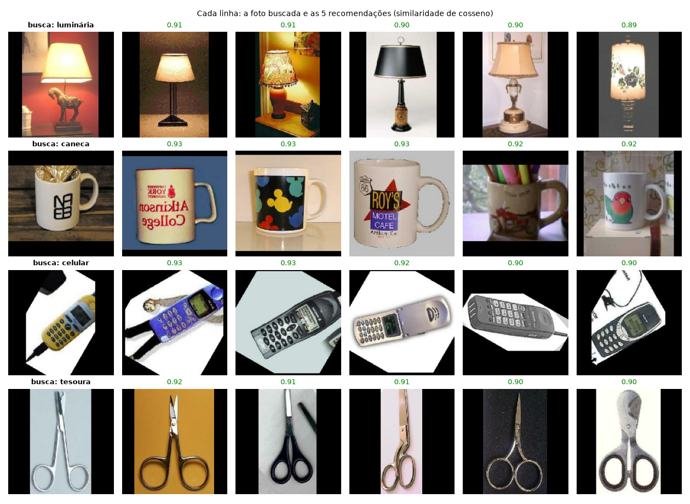

# Recomendação de produtos por imagem

Desafio "Criando um Sistema de Recomendação por Imagens Digitais", da formação Machine Learning Specialist da DIO. A ideia é a de uma loja on-line: a pessoa olha a foto de um produto e o site sugere outros **visualmente parecidos**, sem depender de nome, categoria ou descrição. O enunciado pede para treinar uma rede de deep learning com várias classes de objetos e usá-la para indicar produtos semelhantes.



*Cada linha mostra uma foto do conjunto de teste e os 5 produtos mais parecidos do catálogo. Os números são a similaridade de cosseno (verde: mesma categoria).*

## Como funciona

1. **Uma rede aprende a distinguir produtos.** A MobileNetV2, pré-treinada na ImageNet, é ajustada para classificar 10 categorias de produtos do [Caltech-101](https://data.caltech.edu/records/mzrjq-6wc02): relógio, notebook, fone de ouvido, câmera, cadeira, caneca, luminária, guarda-chuva, tesoura e celular.
2. **A penúltima camada vira uma "assinatura visual".** Antes da camada de classificação há uma camada de 256 neurônios (`embedding`). Ao aprender a separar as categorias, ela passa a resumir cada foto num vetor em que produtos parecidos ficam próximos.
3. **Recomendar é procurar os vetores mais próximos.** Todas as fotos do catálogo viram vetores. A foto consultada também, e as recomendações são as de maior **similaridade de cosseno**, sem incluir o próprio item consultado.

## Resultado

A métrica que importa para recomendação é a **precisão@5**: das 5 sugestões, quantas são da mesma categoria do produto consultado. Ela foi medida com as 465 fotos de teste, buscando num catálogo com as 300 de treino.

| | precisão@5 |
| --- | --- |
| só com os pesos da ImageNet, sem treino | 0,944 |
| **depois do treino** | **0,958** |

O classificador acerta 96,1% das categorias no teste. A comparação com a linha de base mostra quanto o treino acrescenta: os recursos genéricos da ImageNet já agrupam bem objetos parecidos, e o ajuste nas categorias da loja tira os erros que sobravam.

## Rodando

```bash
pip install -e '.[dev]'
python -m recomendacao.treinar          # baixa o Caltech-101 (~130 MB), treina e monta o catálogo
python -m recomendacao.recomendar minha_foto.jpg --k 5
```

O `recomendar` aceita qualquer foto, inclusive de fora do catálogo, e grava `recomendacoes.png` com a foto e as sugestões. O extrator treinado já está em `modelo/extrator.keras`. O catálogo (vetores e miniaturas) é gerado localmente pelo `treinar`, porque as fotos do Caltech-101 não são redistribuídas aqui. Com GPU, o treino leva menos de dois minutos.

| Arquivo | Papel |
| --- | --- |
| `recomendacao/dados.py` | carrega as 10 categorias do Caltech-101 |
| `recomendacao/modelo.py` | classificador e extrator de embeddings, que compartilham as camadas |
| `recomendacao/indice.py` | busca por cosseno e precisão@k |
| `recomendacao/treinar.py` | linha de base, treino em duas fases, catálogo e figuras |
| `recomendacao/recomendar.py` | recomendação para uma foto qualquer |

## Testes

```bash
pytest
```

Os testes cobrem a busca (ordem por similaridade, indiferença à escala do vetor, exclusão do próprio item), o cálculo da precisão@k e a ligação entre classificador e extrator: os dois usam a mesma camada de embedding, então treinar um treina o outro. O GitHub Actions roda lint e testes a cada push.
